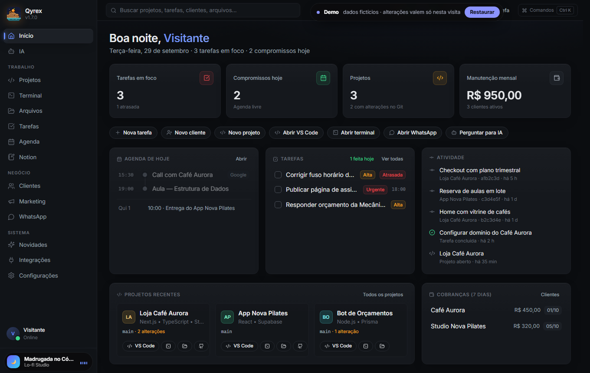
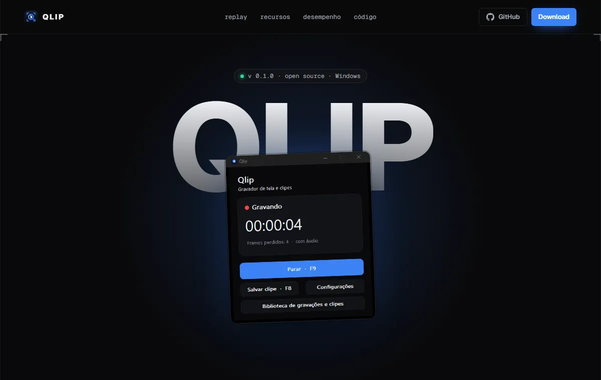

  

  <a href="https://pqueiroz.vercel.app/">Portfólio</a> ·
  <a href="https://pqueiroz.vercel.app/Pedro-Queiroz-Curriculo.pdf">Currículo (PDF)</a> ·
  <a href="https://www.linkedin.com/in/pedro-henrique-da-silva-queiroz-3a073a353/">LinkedIn</a> ·
  <a href="mailto:pqueirozdev@gmail.com">pqueirozdev@gmail.com</a> ·
  <a href="https://pqueiroz.vercel.app/en/">English</a>

## Sobre mim

Sou **Pedro Queiroz**, estudante de **Ciência da Computação no Senac Nações Unidas** e desenvolvedor de software em São Paulo. Desenvolvo aplicações web e desktop com **React, TypeScript, Node.js, C# e C++**, publicadas como projetos open source ou entregues a clientes como freelancer.

**Busco estágio ou vaga júnior em desenvolvimento de software.** Também atendo projetos freelance de sites, sistemas web e automações.

## Projetos principais

| Projeto | O que é | Stack |
| :-- | :-- | :-- |
| **[Qyrex](https://github.com/PQueirozDev/Qyrex)** | Central de trabalho desktop para devs: projetos, tarefas, terminal, Git visual e IA que só executa comandos com permissão. Open source (MIT). | Electron · React · TypeScript · SQLite |
| **[Qlip](https://github.com/PQueirozDev/Qlip)** | Gravador de tela e replay instantâneo para Windows, nativo, com captura e codificação na GPU. Open source (MIT). | C++20 · Win32 · NVENC · FFmpeg |
| **[Qrztweaks](https://github.com/PQueirozDev/Optimizer)** | Otimização e manutenção do Windows: ajustes revisados item a item com backup e reversão, laboratório de desempenho e atualizações com hash assinado. Produto comercial. | C# · WPF · .NET 8 |
| **[Atelier 31](https://github.com/PQueirozDev/atelier-31-barbearia)** | Site de barbearia (fictícia) com agendamento online, Row Level Security e bloqueio de horários duplicados no banco. | React · TypeScript · Supabase |

Os estudos de caso, com problema, arquitetura, desafios e aprendizados, estão no **[portfólio](https://pqueiroz.vercel.app/#projetos)**.

  
  

<b>Outros projetos</b>

- **[PQueiroz Video Studio](https://github.com/PQueirozDev/PQueiroz-Video-Studio)**: editor de vídeo guiado por conversa com o Claude (Electron, React, FFmpeg).
- **[InstallAll](https://github.com/PQueirozDev/InstallAll)**: download de mídia pública compatível com API Express, validação contra SSRF e Docker.
- **[Zekro](https://github.com/PQueirozDev/barberflow)**: SaaS de agendamento para barbearias (Next.js, Supabase).
- **[Capivarudo](https://github.com/PQueirozDev/Bot-Normermo)**: bot de segurança para Discord (TypeScript, discord.js, Prisma).
- **[Onde Fica?](https://github.com/PQueirozDev/POCPI)**: prova de conceito de jogo educacional em C com Allegro 5 (Projeto Integrador, Senac).
- Sites de demonstração: **[Bravus Barbearia](https://pqueirozdev.github.io/bravus-barbearia/)** e **[Lúmina Estética](https://pqueirozdev.github.io/lumina-estetica/)**.

## Tecnologias

- **Front-end:** TypeScript, JavaScript, React, Next.js, HTML, CSS, Tailwind CSS
- **Back-end e dados:** Node.js, Express, PostgreSQL, Supabase, Prisma, SQLite · Python (básico)
- **Desktop e sistemas:** Electron, C++ / Win32, C# / WPF (.NET), C
- **Ferramentas:** Git, GitHub, Docker, Vitest, FFmpeg, CMake, Vercel
- **IA:** Claude Code e Codex no desenvolvimento e na revisão de código; APIs do Claude, OpenAI e Gemini integradas ao Qyrex

## Trajetória

| Quando | O quê |
| :-- | :-- |
| 2025 → hoje | Desenvolvedor freelancer: sites, automações e o sistema de orçamentos da Aquecedores Fortes |
| 2026 → 2030 | Bacharelado em Ciência da Computação · Senac Nações Unidas (em andamento) |
| Concluído | Ensino Médio Técnico em Administração · Senac Jabaquara |
